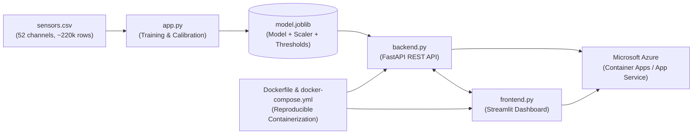

<div align="center">

# 🛠️ Pump Sensor Failure Detector

### Real-time industrial pump monitoring — from 52-channel sensor streams to an Azure-ready detection service


[Overview](#-overview) · [How It Works](#-how-it-works) · [Key Features](#-key-features) · [Project Structure](#-project-structure) · [Deployment & Setup](#-deployment--setup) · [Use Cases](#-use-cases)

</div>

---

## 📖 Overview

Industrial pump failures rarely announce themselves in advance — sensors drift, vibration patterns shift, and by the time an operator notices, the damage is done. Built during a summer research internship to close that operational gap, **Pump Sensor Failure Detector** ingests real-valued sensor telemetry and classifies each reading as `NORMAL`, `UNUSUAL`, `RECOVERING`, or `FAILURE` inside an interactive dashboard.

Raw data in `sensors.csv` spans 52 motor, pump, and bearing channels across roughly 220,000 rows with severe class imbalance (fewer than 10 `BROKEN` rows). Rather than relying on a single classifier with inflated accuracy, the pipeline pairs a class-weighted **XGBoost** model and block-based temporal split with a z-score anomaly detector calibrated strictly on `NORMAL` training rows, then fuses both signals at inference time.

Packaging the **inference pipeline** with **Docker** and deploying to **Microsoft Azure** (via Azure Container Apps or App Service) keeps local development and cloud serving aligned, eliminating environment drift during research handoffs.

---

## 🧠 How It Works

### System Architecture



### Step-by-Step Pipeline

1. **Data preparation (`app.py`)**
* Loads `sensors.csv` with `index_col=0` so the row-index column does not leak into training as a spurious feature.
* Drops columns with more than 30% missing values and applies forward- and backward-fill to the remaining channels during **exploratory data analysis** and preprocessing.
* Parses timestamps, sorts rows chronologically, and maps machine status labels (`NORMAL`, `RECOVERING`, `BROKEN`) to `{0, 1, 2}` using `.map().astype(int)` to avoid object-dtype pitfalls in newer `pandas`.


2. **Temporal feature split**
* Groups chronological rows into 1,000-row blocks instead of using a random split, preventing adjacent-row leakage across train and test sets.
* Selects a split offset that retains all three classes in the test partition so **model evaluation** reflects real deployment conditions.


3. **Modelling & feature engineering (`app.py`)**
* Fits `StandardScaler` on training rows only, then trains `XGBClassifier` using `compute_sample_weight(class_weight='balanced')` to address extreme minority-class scarcity.
* Ranks all 52 sensors by fitted feature importance and searches `n = 2…50` to pick the top 9 features balancing test accuracy, weighted F1, and ROC-AUC:
`sensor_07`, `sensor_05`, `sensor_00`, `sensor_51`, `sensor_36`, `sensor_11`, `sensor_32`, `sensor_04`, `sensor_10`.


4. **Anomaly threshold calibration (`app.py`)**
* Computes each row's mean absolute z-score across the 9 selected sensors relative to `NORMAL` training statistics.
* Sets `anomaly_threshold` at the 99th percentile and `severe_threshold` at the 99.9th percentile of `NORMAL` training scores—without inspecting failure rows—to keep evaluation honest.


5. **Bundle serialization (`model.joblib`)**
* Saves a single self-contained artifact via `joblib.dump` containing:
* `model`: fitted `XGBClassifier` on the top-9 features
* `scaler`: `StandardScaler` fitted on the top-9 training rows
* `top_features`: ordered list of the 9 selected sensor names
* `baseline_mean/std`: `NORMAL` training statistics (`pd.Series`)
* `anomaly_threshold` & `severe_threshold`: 99th and 99.9th percentile cutoffs
* `fill_values`: training-set feature medians for missing-value imputation
* `labels`: `{0: "NORMAL", 1: "RECOVERING", 2: "BROKEN"}`
* `metrics`: test-set accuracy, weighted F1, and ROC-AUC
* `examples`: sample `NORMAL`, `RECOVERING`, and `BROKEN` readings


6. **Inference & UI serving (`backend.py` → `frontend.py`)**
* `backend.py` loads `model.joblib` once at startup and exposes two **REST API** endpoints:
* `GET /health` — returns feature names, thresholds, evaluation metrics, and example readings for service checks and **logging & monitoring**.
* `POST /detect` — accepts a batch of sensor rows in JSON, applies median fill → scaling → XGBoost → z-score anomaly scoring, and fuses predictions:
* `RECOVERING` if XGBoost predicts class `1`
* `FAILURE` if XGBoost predicts class `2` **or** `anomaly_score > severe_threshold`
* `UNUSUAL` if `anomaly_score > anomaly_threshold`
* `NORMAL` otherwise


* `frontend.py` queries `/health` on load and `/detect` on interaction without importing the model directly, keeping UI and inference decoupled.


> 💡 **Tip:** `frontend.py` reads `API_URL` from the environment (default `http://localhost:8000`). Inside `docker-compose.yml`, `API_URL=http://backend:8000` routes traffic across the internal Docker network rather than the host.

---

## ⚡ Key Features

* **Dual-signal failure detection:** Fuses `XGBClassifier` status probabilities with z-score anomaly thresholds (`anomaly_threshold` and `severe_threshold`) to catch abnormal excursions that status labels alone might miss.
* **Leakage-resistant evaluation:** Uses 1,000-row temporal blocks and class-aware split selection so test accuracy, weighted F1, and ROC-AUC are not inflated by neighboring rows.
* **Self-contained `model.joblib` artifact:** Bundles the trained model, scaler, fill medians, anomaly thresholds, metrics, and example readings into one file for **reproducibility** across environments.
* **FastAPI inference service:** Exposes `GET /health` and `POST /detect` for batch scoring and health checks, keeping model serving isolated from the presentation layer.
* **Interactive Streamlit dashboard:** Provides a replay slider, per-reading status banner, anomaly gauge, class probability chart, timeline with shaded failure regions, and a detected-episode table.
* **Single-image Docker & Azure deployment:** Builds one `python:3.15.2-slim-bookworm` image via `Dockerfile` and `.dockerignore`, orchestrates both services in `docker-compose.yml` behind a health check, and deploys cleanly to **Microsoft Azure** (Container Apps or App Service).

---

## 📁 Project Structure

| File | Role |
| --- | --- |
| `sensors.csv` | Raw 52-channel industrial pump sensor dataset (~220,000 timestamped rows) used during offline training and evaluation |
| `app.py` | Offline training and calibration script: data cleaning, 1,000-row temporal split, balanced XGBoost training, top-9 feature selection, anomaly threshold tuning, and `model.joblib` export |
| `model.joblib` | Serialized inference bundle containing the top-9 XGBoost model, scaler, anomaly/severe thresholds, median fill values, evaluation metrics, and example readings |
| `backend.py` | **FastAPI** service loading `model.joblib` at startup and serving `GET /health` and `POST /detect` for batch inference and **logging & monitoring** |
| `frontend.py` | **Streamlit** dashboard calling the backend REST API to render the replay slider, status banner, anomaly gauge, probability chart, failure timeline, and episode table |
| `Dockerfile` | Builds a `python:3.15.2-slim-bookworm` image containing the runtime code and `model.joblib` with pinned dependencies from `requirements.txt` |
| `.dockerignore` | Excludes `.venv`, `sensors.csv`, `app.py`, and non-runtime files from the Docker build context so only required runtime artifacts enter the image |
| `docker-compose.yml` | Runs `backend` and `frontend` from the shared image over the internal network, gating frontend startup on the backend health check |
| `requirements.txt` | Pinned Python package versions (such as `pandas==3.1.1`, `xgboost==3.4.1`, `scikit-learn==1.9.1`) for deterministic builds |

> 💡 **Tip:** `sensors.csv` and `app.py` are excluded by `.dockerignore` and never copied into the runtime container; training runs offline and only `model.joblib` is shipped to serving environments.

---

## 🚀 Deployment & Setup

### Prerequisites

* **Python 3.15.2** (for local execution without Docker)
* **Docker Desktop** or **Docker Engine** on Linux (for local container orchestration)
* **Azure CLI** (`az`) with an active subscription (for **Microsoft Azure** deployment)

### Local — Without Docker

```bash
# 1. Create and activate a virtual environment
python -m venv .venv
source .venv/bin/activate        # Windows: .venv\Scripts\activate

# 2. Install pinned dependencies
pip install -r requirements.txt

# 3. Terminal 1 — start the FastAPI backend
uvicorn backend:app --reload --port 8000

# 4. Terminal 2 — start the Streamlit dashboard
streamlit run frontend.py

```

Open `http://localhost:8501` for the Streamlit dashboard and `http://localhost:8000/docs` for interactive OpenAPI documentation.

### Local — With Docker Compose

```bash
# Build the shared image and start backend + frontend
docker compose up --build

# Verify runtime files inside /app
docker run --rm pump-detection ls /app

# Stop and remove containers
docker compose down

```

`docker-compose.yml` gates the frontend on the backend's health check so the dashboard does not start before `model.joblib` is loaded.

> ⚠️ **Note:** After regenerating `model.joblib` via `app.py`, run `docker compose up -d --build` so the container image picks up the updated artifact; code reloaders do not automatically detect changes inside `model.joblib`.

### Microsoft Azure Deployment

#### Option A — Azure Container Apps (Recommended)

```bash
# 1. Authenticate and select subscription
az login
az account set --subscription "<your-subscription-id>"

# 2. Create a resource group and Azure Container Registry
az group create --name pump-rg --location eastus
az acr create --resource-group pump-rg --name pumpacrregistry --sku Basic
az acr login --name pumpacrregistry

# 3. Build and push the container image
docker build -t pumpacrregistry.azurecr.io/pump-detection:latest .
docker push pumpacrregistry.azurecr.io/pump-detection:latest

# 4. Create a Container Apps environment
az containerapp env create \
  --name pump-env \
  --resource-group pump-rg \
  --location eastus

# 5. Deploy the internal API service
az containerapp create \
  --name pump-backend \
  --resource-group pump-rg \
  --environment pump-env \
  --image pumpacrregistry.azurecr.io/pump-detection:latest \
  --command "uvicorn" "backend:app" "--host" "0.0.0.0" "--port" "8000" \
  --target-port 8000 --ingress internal

# 6. Deploy the external dashboard (replace <BACKEND_FQDN> with the internal FQDN)
az containerapp create \
  --name pump-frontend \
  --resource-group pump-rg \
  --environment pump-env \
  --image pumpacrregistry.azurecr.io/pump-detection:latest \
  --command "streamlit" "run" "frontend.py" \
    "--server.address=0.0.0.0" "--server.port=8501" "--server.headless=true" \
  --target-port 8501 --ingress external \
  --env-vars "API_URL=http://<BACKEND_FQDN>:8000"

```

> 💡 **Tip:** Keep `pump-backend` on `--ingress internal` within the Container Apps environment and expose only `pump-frontend` externally.

#### Option B — Azure App Service

Deploy the container image from Azure Container Registry to an Azure App Service Web App for the backend, then configure `API_URL` on the frontend container app setting to point at the backend URL.

> ⚠️ **Note:** Free and `B1` App Service plans can experience cold starts (~1 minute delay) after idle periods; use a `Standard S1` plan or keep minimum replicas warm in Azure Container Apps during live demos.

---

## 🎯 Use Cases

* **Predictive maintenance & SCADA integration:** Connect external telemetry collectors or monitoring scripts to `POST /detect` and `GET /health` to flag `UNUSUAL` and `FAILURE` conditions early and track service health.
* **Multi-pump & multi-asset rollouts:** Run `app.py` on telemetry from other pumps or rotating equipment to produce a new `model.joblib` bundle, swapping the artifact without altering `backend.py` or `frontend.py`.
* **Scheduled batch scoring:** Send batches of CSV sensor rows to `POST /detect` from cron jobs or Azure workflows to generate periodic condition reports.
* **Model comparison & A/B testing:** Because the REST API separates inference from the Streamlit UI, a candidate `model.joblib` can run on a parallel container for side-by-side evaluation before promotion.
* **Automated CI/CD retraining:** Pair `app.py` with a **CI/CD** pipeline (such as GitHub Actions) that retrains on fresh sensor logs, checks evaluation metrics, and pushes an updated image to Azure Container Registry.
