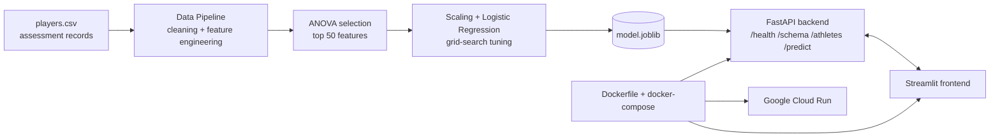
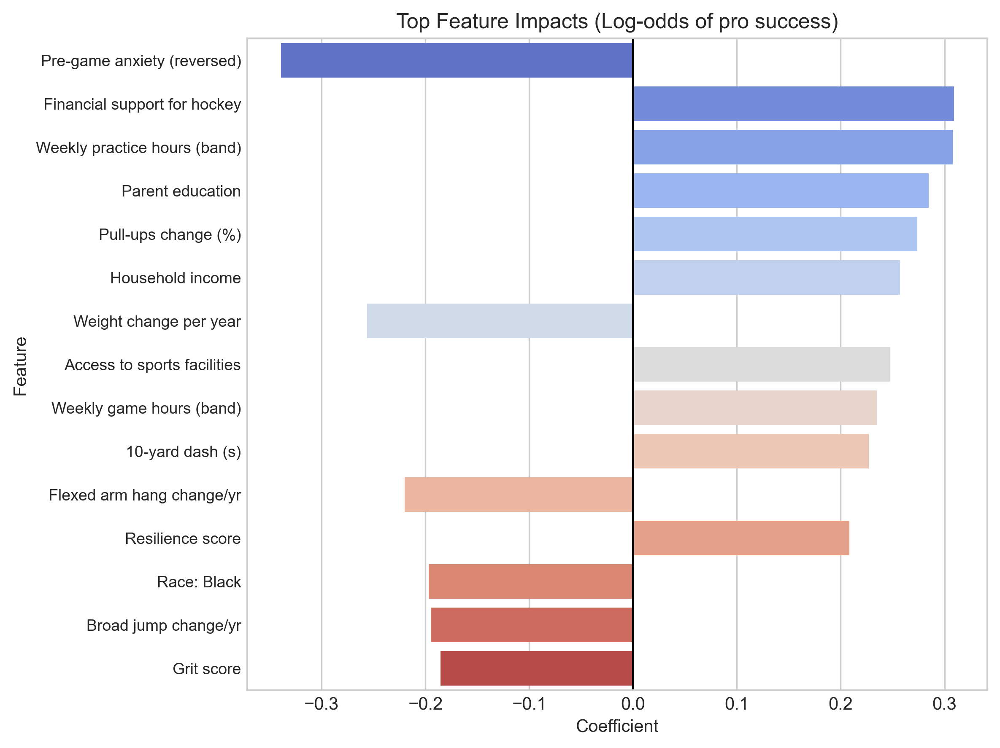
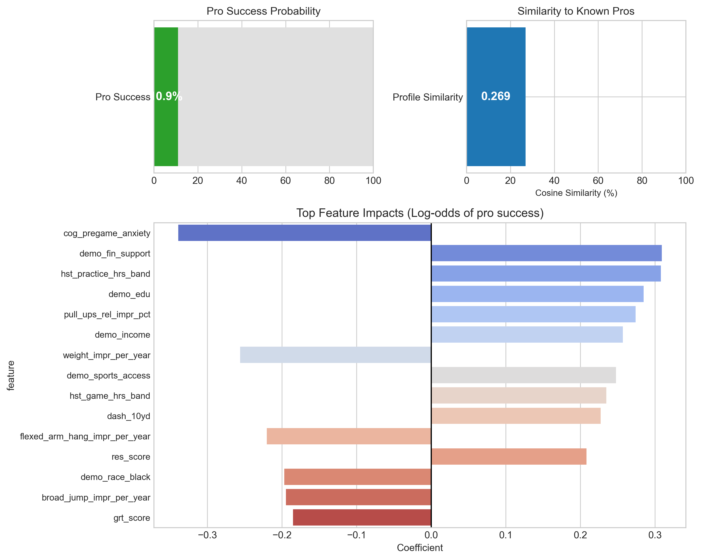
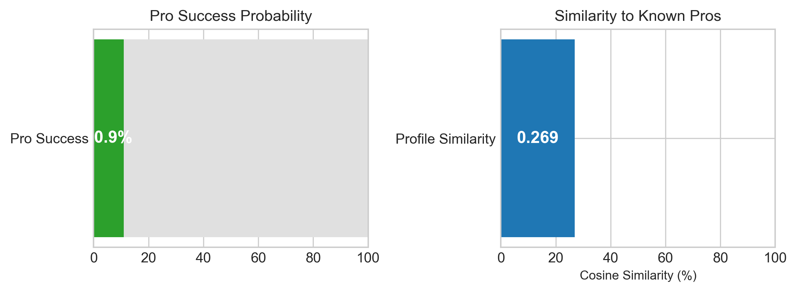

<div align="center">

# 🏒 IceBreaker

### Pro Hockey Talent Identifier — from raw athlete assessments to a deployable prediction API


*Built for **Pittsburgh Penguins Performance Training (PPPT)***

[Overview](#-project-overview) · [How It Works](#-model-architecture--how-it-works) · [Features](#-key-features) · [Structure](#-project-structure) · [Setup & Deployment](#-deployment--local-setup-guide) · [Use Cases](#-industry-use-cases--applications)

</div>

---

## 📖 Project Overview

Identifying which young hockey players have the profile of a future professional is hard. The evidence is scattered across physical testing sessions, psychological questionnaires, training histories, and background information, and it is usually weighed by hand and by feel.

**IceBreaker** was created for **Pittsburgh Penguins Performance Training (PPPT)** to turn that scattered evidence into a single, consistent, data-driven view of an athlete. Staff enter an athlete's assessment results (or load a saved record), and IceBreaker returns:

- 🎯 a **pro-success probability** (0–100%),
- 📐 a **similarity score** against athletes who went on to reach pro level,
- 🔍 a ranked list of the **factors that pushed the score up or down** for that specific athlete.

The whole system is a trained model, a **REST API**, and an interactive web app, packaged with **Docker containerization** so the same image runs on a laptop or on **Google Cloud Run**.

> ⚠️ **Note:** IceBreaker is a decision-support and exploratory tool, not a selection verdict. It was trained on a small cohort (see [Model Evaluation](#-model-evaluation)) and should inform, never replace, coach and scout judgment.

---

## 🧠 Model Architecture & How It Works

### System Architecture



| Layer | Implementation |
|---|---|
| **Training** | `app.py`, a cell-by-cell Python script (`# %%`) covering data loading, **Feature Engineering**, **Hyperparameter Tuning**, and **Model Evaluation** |
| **Artifact** | `model.joblib`: imputer, ANOVA selector, scaler, classifier, reference embeddings, and metadata in one file |
| **Inference Pipeline** | `backend.py`: **FastAPI** service that validates, imputes, scores, and explains each request |
| **Interface** | `frontend.py`: **Streamlit** app generated from the backend's `/schema`, so the form always matches the model |
| **Packaging** | **Docker** image (`python:3.12-slim`) orchestrated with Docker Compose; deployable to **GCP Cloud Run** |

### Step-by-Step Methodology

**1. Data Pipeline & Feature Engineering**
- Loads `players.csv` and keeps fully profiled athlete records (**80 athletes** after filtering).
- Cleans percentage strings and coerces physical test results to numeric values.
- Builds **improvement features** for every physical test: absolute change, relative change (%), and change per year between testing sessions.
- Adds `<test>_measured` flags so the model can distinguish "not tested" from "tested and average".
- Imputes heavily missing tests with **group-wise medians** (by competition category and gender), then global medians for the rest.

**2. Feature Selection**
- Runs an **ANOVA F-test (`SelectKBest`)** and keeps the **top 50 features** out of the full engineered set.

**3. Model Training & Loss Optimization**
- Standardizes features (`StandardScaler`) and trains a **Logistic Regression** classifier, optimizing regularized log-loss with the `saga` solver and balanced class weights.
- **Hyperparameter Tuning** via stratified 5-fold `GridSearchCV`, scored by ROC-AUC.

| Setting | Value |
|---|---|
| Train / test split | 80 / 20, stratified (64 / 16 athletes), `random_state=42` |
| Feature selection | ANOVA F-test, `k = 50` |
| Classifier | Logistic Regression (`saga`, `class_weight="balanced"`, `max_iter=2000`) |
| Search grid | `C ∈ {0.01, 0.03, 0.1}` × regularization `{L1, L2}` |
| Cross-validation | Stratified 5-fold, scoring = ROC-AUC |
| **Selected model** | **L2-regularized, `C = 0.1`** |
| Similarity search | Cosine similarity, top 15 reference profiles |

**4. Inference Pipeline (served by the API)**
1. **Validate** input types; unknown keys are ignored, bad values return a clear `422`.
2. **Score questionnaires** server-side (1–5 answers → composite scores such as grit, resilience, and mental toughness).
3. **Derive progress features** from previous test results and the time between tests.
4. **Impute → scale** with the exact transformers fitted during training. Requests with more than half of the model inputs missing are rejected.
5. **Predict** the probability of pro-level success.
6. **Compare** the athlete's standardized feature vector with **44 reference profiles** of athletes who made it, using cosine similarity in that shared **feature-embedding space**.
7. **Explain** the result: for a linear model, each feature's contribution is exactly `coefficient × standardized value`, giving per-athlete drivers without any approximation.

### 📊 Model Evaluation

Evaluated on a stratified hold-out set of **16 athletes**:

| Metric | Score |
|---|---|
| Accuracy | **93.75%** |
| ROC-AUC | **0.984** |
| PR-AUC | **0.988** |
| Precision | 1.00 |
| Recall | 0.889 |
| F1 | 0.941 |

<table>
  <tr>
    <td align="center"><b>Feature Impacts</b><br></td>
    <td align="center"><b>Prediction Results</b><br></td>
  </tr>
</table>

<p align="center">
  <b>Prediction Scores</b><br>
  
</p>

> ⚠️ **Note:** With only 16 test athletes, each misclassification moves accuracy by about 6 points, and preprocessing statistics were fitted on the full dataset before the split. Treat these numbers as optimistic. A leakage-free pipeline and repeated cross-validation are the natural next step.

> ⚠️ **Note on responsible use:** The model uses background and access-related inputs (household income, parent education, financial support, and demographic fields). These can reflect *access to hockey* rather than *talent*. Audit or remove them before using scores in any real selection decision.

---

## ⚡ Key Features

| | Feature | Details |
|---|---|---|
| 🎯 | **Pro-success probability** | Calibrated-style 0–100% score from a regularized logistic regression |
| 📐 | **Pro-profile similarity** | Cosine similarity to 44 reference profiles, plus the closest matching athletes |
| 🔍 | **Per-athlete explanations** | Bar chart of the inputs that raised or lowered *this* athlete's score |
| 🧩 | **Schema-driven UI** | The form is generated from the model's `/schema`: 50 inputs across Background, Cognitive Assessment, Training & Lifestyle, Physical Assessment, and Progress |
| 🧠 | **Built-in questionnaires** | Five 1–5 scale questionnaires scored by the backend, with required-field tracking |
| 📈 | **Progress tracking** | Enter previous results and time between tests; improvement metrics are computed automatically |
| 🗂️ | **Saved-record lookup** | Load an existing athlete by ID (optional; enabled when `players.csv` is available) |
| 🔌 | **REST API** | `GET /health` · `GET /schema` · `GET /athletes/{id}` · `POST /predict`, with auto-generated Swagger docs at `/docs` |
| 🐳 | **One-image deployment** | The same Docker image runs both services; Compose wires them together with health checks |
| 🩺 | **Production Monitoring hooks** | `/health` reports model status and metrics for load balancers, Compose health checks, and uptime checks |

---

## 📁 Project Structure

```
IceBreaker/
├── app.py
├── backend.py
├── frontend.py
├── model.joblib
├── players.csv
├── output/
├── requirements.txt
├── Dockerfile
├── docker-compose.yml
├── .dockerignore
├── .gitignore
└── README.md
```

| File / Directory | Description |
|---|---|
| `app.py` | 🔬 Training workflow written as `# %%` cells: load data, explore, engineer features, tune, evaluate, plot, and dump the model to `model.joblib` |
| `backend.py` | 🧩 **FastAPI** inference service (`/health`, `/schema`, `/athletes/{id}`, `/predict`) with validation, questionnaire scoring, and explanations |
| `frontend.py` | 🖥️ **Streamlit** web app: dynamic form, results dashboard, and driver chart |
| `model.joblib` | 🤖 Serialized artifact: imputer, ANOVA selector, scaler, logistic regression, reference embeddings, and evaluation metadata |
| `players.csv` | 🗂️ Source assessment data used for training and saved-record lookup *(not committed; supply your own)* |
| `output/` | 📊 Evaluation figures: ROC, PR, confusion matrix, correlation heatmap, feature impacts, and prediction scores |
| `requirements.txt` | 📦 Pinned dependency versions for reproducible builds |
| `Dockerfile` | 🐳 Slim Python 3.12 image shared by the backend and frontend |
| `docker-compose.yml` | 🧱 Runs both services, with a backend health check and the frontend waiting on it |
| `.dockerignore` | 🧹 Keeps data, notebooks-style scripts, outputs, and docs out of the image |

> 💡 **Tip:** `model.joblib` is pickled with scikit-learn **1.9.1**. Keep `requirements.txt` pinned and retrain (run `app.py`) if you change library versions.

> ⚠️ **Note:** Athlete-level data (`players.csv`) is intentionally excluded from version control and from the Docker image.

---

## 💡 Industry Use Cases & Applications

| Use Case | How IceBreaker Helps |
|---|---|
| 🏒 **Youth talent identification** | Gives scouts and performance staff a consistent, quantified starting point for comparing prospects across categories and testing sessions |
| 📋 **Individual development planning** | Per-athlete drivers show which attributes (training load, mindset scores, physical progress) are pulling a profile up or down, so coaches know where to focus |
| 📈 **Longitudinal progress monitoring** | Improvement features turn repeated testing into a trend signal, rewarding athletes who are developing faster than their peers |
| 🏟️ **Sports-science analytics platforms** | The API-first design lets the model plug into existing dashboards, athlete management systems, or other **REST API integration** workflows |
| 🔁 **Template for other sports** | The pipeline (assessment data → engineered features → explainable model → API → UI) carries over to any sport with structured testing data |

---

## 📜 License & Acknowledgements

Released under the [MIT License](LICENSE).

**Acknowledgements**
- **Pittsburgh Penguins Performance Training (PPPT)**, the organization this project was built for.
- Built with [scikit-learn](https://scikit-learn.org), [FastAPI](https://fastapi.tiangolo.com), [Streamlit](https://streamlit.io), and [Docker](https://www.docker.com).

> 💡 **Tip:** Found an issue or have an idea? Pull requests are welcome, especially for leakage-free evaluation, fairness auditing of the background features, and additional explainability views.
